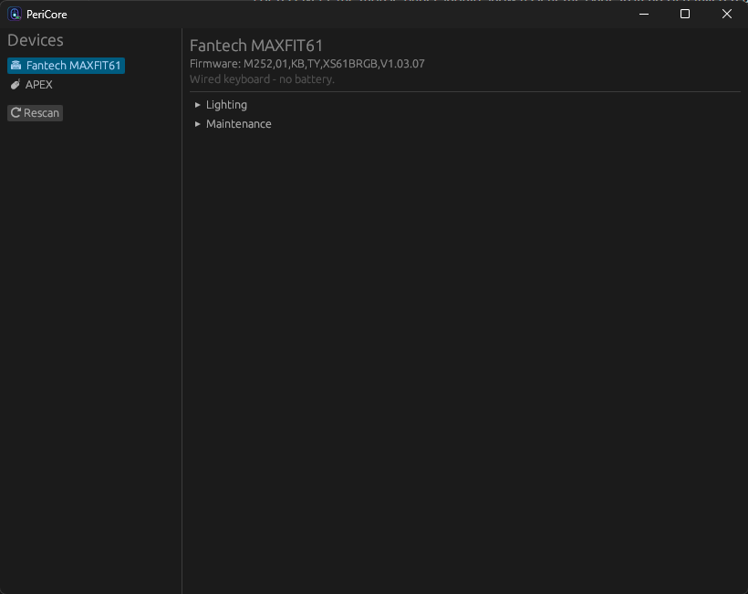

<p align="center">
  
</p>

<h1 align="center">PeriCore</h1>

<p align="center">
  <b>One tiny, instant-start Windows app for your Ajazz mouse and Fantech keyboard.</b><br>
  Battery % in the system tray &middot; device settings in one window &middot; written in Rust.
</p>

<p align="center">
  <a href="../../releases/latest"><b>⬇ Download PeriCore.exe</b></a>
</p>

---

## Why

The vendor apps are heavy: the AJAZZ Driver is a 136 MB Electron app plus a background helper, and the FANTECH app is a Qt bundle. Checking your mouse battery means opening one of them and waiting.

PeriCore is a **single 4.5 MB `.exe`** that:

- opens in about **0.2 s**
- sits in the tray using **~13 MB RAM** and shows your wireless mouse's **battery percentage as the icon itself**
- puts both devices' settings in one window

<p align="center">
  
</p>

## Features

### Tray battery indicator
- Live battery % drawn into the tray icon, colour-coded: green > 35 %, yellow ≤ 35 %, red ≤ 15 %, grey when the mouse is asleep or off
- Hover for a tooltip with the device name and level
- Polls every 60 s (right-click → **Refresh battery** for an instant update)
- Right-click → **Start with Windows** to launch the tray at login

### Ajazz mouse (AJ159 APEX / AJ179 APEX and other RY-firmware mice)
| Feature | 2.4G receiver | USB cable |
|---|:-:|:-:|
| Battery level | ✅ | – |
| DPI stages (1–8), per-stage colours, active stage | ❌ not yet | ⚠️ untested |
| Polling rate 125 – 8000 Hz | ❌ not yet | ⚠️ untested |
| Debounce, lift-off distance, motion sync, angle snapping, power saving, sleep timer | ❌ not yet | ⚠️ untested |
| Lighting (effect, brightness, speed, colour, rainbow) | ❌ not yet | ⚠️ untested |

Settings over the wireless receiver need one more piece of the receiver handshake that hasn't been decoded yet, so for now PeriCore shows battery only in wireless mode. The settings themselves are implemented, but they haven't been tested over the USB cable yet.

### Fantech MAXFIT61 keyboard
- Firmware / model readout
- Lighting: all 14 on-board effects, brightness, speed, direction, foreground and background colour, rainbow mode, backlight on/off
- Factory reset (with confirmation)
- Wired keyboard, so it has no battery

### Other devices
PeriCore ships with a catalogue of **3,000+ devices** from the Rongyuan (RY) firmware family (Ajazz, Fantech, and many other brands), so other compatible mice and receivers are detected by name automatically.

## Install

1. Download **`PeriCore.exe`** from the [latest release](../../releases/latest). There's no installer.
2. Put it somewhere permanent (e.g. `C:\Program Files\PeriCore\`) and run it.
3. **Close the AJAZZ / FANTECH apps** so they don't send conflicting commands to the devices.
4. Windows 11 hides new tray icons: click the **^** arrow next to the clock and drag the PeriCore icon onto the taskbar to keep the battery % visible.
5. Optional: right-click the tray icon → **Start with Windows**.

> Windows SmartScreen may warn about an unsigned app the first time. Click **More info → Run anyway**.

## Usage

| Command | What it does |
|---|---|
| `PeriCore.exe` | Opens the settings window (and starts the tray if it isn't running) |
| `PeriCore.exe --tray` | Tray battery indicator only (used by *Start with Windows*) |
| `PeriCore.exe --probe` | Prints detected devices and read-only diagnostics |
| `PeriCore.exe --listen 3151 5007 10` | Passively prints a device's vendor input reports for 10 s |

From PowerShell, run a quoted path with `&`:

```powershell
& "C:\Program Files\PeriCore\PeriCore.exe" --probe
```

## Supported hardware

| Device | USB ID | Protocol |
|---|---|---|
| Ajazz 2.4G receiver (AJ159 / AJ179 APEX and others) | `3151:5007` | RY feature reports, receiver status `F7` |
| Ajazz mice over cable | `3151:4026` | RY feature reports |
| Fantech MAXFIT61 (XS61BRGB firmware) | `0416:C345` | 64-byte interrupt reports on interface 2 |

## Build from source

Requires Windows 10/11, the [Rust toolchain](https://rustup.rs) (MSVC), and Visual Studio Build Tools (C++).

```powershell
git clone https://github.com/hyperdargo/PeriCore
cd PeriCore
cargo test
cargo build --release      # -> target\release\PeriCore.exe
```

To regenerate the icon from `assets/pericore.svg`:

```powershell
cargo run --release --manifest-path tools/icongen/Cargo.toml
```

## Project layout

```
src/
  main.rs            mode dispatch (window / --tray / --probe / --listen)
  os.rs              single instance, message pump, autostart, window focus
  hid/               checksum + 65-byte feature-report transport
  devices/
    db.rs            embedded 3000-device catalogue (assets/ry_devices.json)
    ry/              Ajazz / Rongyuan mouse protocol
    fantech/         Fantech MAXFIT61 protocol
  tray/              tray process, battery polling, icon renderer
  ui/                egui settings window (mouse + keyboard panels)
assets/              icon (SVG/ICO/PNG) and device catalogue
docs/                reverse-engineered protocol notes
tools/icongen/       SVG -> ICO/PNG renderer
```

## How it works

Neither vendor publishes a protocol. The notes in [`docs/`](docs/) were worked out by reading the vendor apps' own code: the AJAZZ Driver's JavaScript and its `iot_driver.exe` helper, and the FANTECH Qt app. PeriCore only sends commands those apps send. Settings blocks are read from the device, edited in place and written back, so bytes PeriCore doesn't understand are kept as they were.

## Disclaimer

PeriCore is an independent project, not affiliated with or endorsed by Ajazz or Fantech. Changing device settings is at your own risk. If something looks wrong, the vendor app's reset still works.
