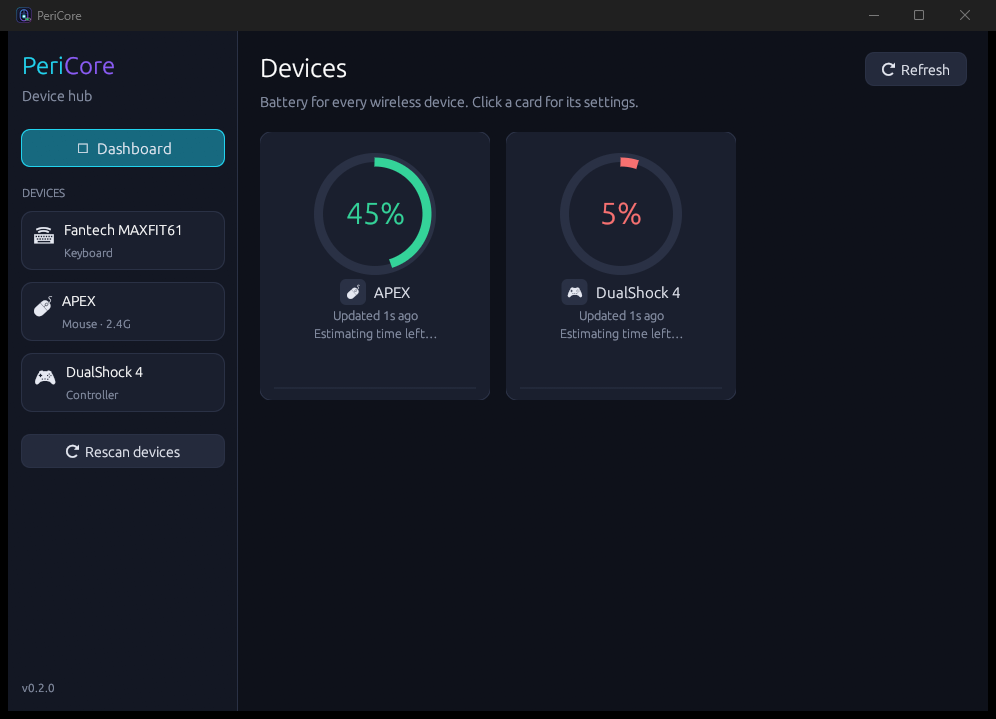

<p align="center">
  
</p>

<h1 align="center">PeriCore</h1>

<p align="center">
  <b>One tiny, instant-start Windows app for your Ajazz mouse, Fantech keyboard, PlayStation controllers and headphones.</b><br>
  Battery dashboard &middot; live battery % in the system tray &middot; device settings in one window &middot; sound presets and mic noise suppression &middot; written in Rust.
</p>

<p align="center">
  <a href="../../releases/latest"><b>⬇ Download PeriCore Setup</b></a>
</p>

---

## Why

The vendor apps are heavy: the AJAZZ Driver is a 136 MB Electron app plus a background helper, and the FANTECH app is a Qt bundle. Checking your mouse battery means opening one of them and waiting.

PeriCore is a **single 5 MB `.exe`** that:

- opens in about **0.2 s**
- sits in the tray using **~13 MB RAM** and shows each wireless device's **battery percentage as its own icon**
- opens on a **battery dashboard** with time left, and puts every device's settings in one window

<p align="center">
  
</p>

## Features

### Battery dashboard
- Opens first: one card per device with a ring gauge, **time left** ("~7 h left", "~1 h to full"), "Updated 40s ago" and a 24-hour history line
- Devices seen in the last week but not connected now show their last level
- Click a card to open that device's settings
- History is kept locally in `%APPDATA%\PeriCore\battery-history.json` (7 days, never uploaded)

### Tray battery indicator
- One tray icon per device, with a small **mouse or controller picture** so you know which is which
- Live and laptop-style: the fill follows the level, a charging battery animates with a bolt, a full one on power shows a check mark, and a sleeping mouse is dimmed (its last known level)
- Colour-coded: green > 35 %, yellow ≤ 35 %, red ≤ 15 %, grey when unknown
- Hover for the name, level and estimated time left
- Polls every 20 s (right-click → **Refresh battery** for an instant update)
- Right-click → **Start with Windows** to launch the tray at login
- Stays on the taskbar: Windows 11 puts new tray icons behind the **^** arrow, so PeriCore moves each of its icons out once. If you hide one again in Settings, that sticks.
- Optional: right-click → **Show battery on taskbar** also draws the levels next to the tray arrow, using the Windows icon font

### Ajazz mouse (AJ159 APEX / AJ179 APEX and other RY-firmware mice)
| Feature | 2.4G receiver | USB cable |
|---|:-:|:-:|
| Battery level | ✅ | ✅ |
| DPI stages (1–8), per-stage colours, active stage | ✅ verified | ⚠️ untested |
| Polling rate 125 – 8000 Hz | ✅ verified | ⚠️ untested |
| Debounce, lift-off distance, ripple correction, angle snapping, double-click guard, sleep timer | ✅ verified | ⚠️ untested |
| Button remapping (mouse, keyboard keys and shortcuts, media, DPI, rapid fire, macros) | ✅ verified | ⚠️ untested |
| On-board macros (record or build, repeat / toggle / while held) | ✅ | ⚠️ untested |
| Dock screen: upload a picture or animated GIF (up to 222 frames), clock sync | ✅ verified | – |

Over the 2.4G receiver the mouse has to be awake, so if PeriCore says it's asleep, move it and press Reload. **Close the AJAZZ app before uploading to the dock screen**: its background helper takes over the receiver and the upload silently fails (PeriCore detects it and offers to close it).

The receiver doesn't report charging, so the charging state only shows for wired mice and controllers.

### Fantech MAXFIT61 keyboard
- Firmware / model readout
- Lighting: every on-board effect by name (Static, Neon, Breathing, Wave, Aurora, Ripple…), brightness, speed, direction, colours, rainbow mode, backlight on/off
- Per-key colours: paint keys on a drawing of the keyboard
- Key remapping: any key to another key, a shortcut (up to two modifiers), Fn, a macro, or disabled
- On-board macros (10 slots)
- Factory reset (with confirmation)
- Wired keyboard, so it has no battery

### PlayStation controllers
- DualShock 4, DualSense and DualSense Edge, over **USB or Bluetooth**
- Battery level plus charging / full state, read straight from the controller (no other app needed)
- Own tray icon, dashboard card and a live battery page

### Sound (every app)
- **Sound modes:** Flat, Music, Movies, Games, Vocal and Bass boost, plus a 10-band equalizer for your own curve. Headroom is added automatically so boosts don't clip.
- **Headphone correction:** import the AutoEQ `ParametricEQ.txt` for your exact IEM or headphones (from [autoeq.app](https://autoeq.app)) so it sounds neutral before the sound mode is applied.
- **Mic noise suppression:** removes keyboard, fan and background noise from your microphone in every app (Discord, games, calls), using the free [RNNoise plugin](https://github.com/werman/noise-suppression-for-voice).
- Pick which output and which microphone it applies to.

Windows only lets an app change other apps' sound through an audio add-on, so this uses the free [Equalizer APO](https://sourceforge.net/projects/equalizerapo/). Install it once, tick your headphones and microphone in its Device Selector, restart, then press **Connect** on PeriCore's Sound page (your previous Equalizer APO settings are backed up to `config-before-pericore.txt`). RNNoise needs the mic set to 48 kHz.

### Other devices
PeriCore ships with a catalogue of **3,000+ devices** from the Rongyuan (RY) firmware family (Ajazz, Fantech, and many other brands), so other compatible mice and receivers are detected by name automatically.

## Install

1. Download **`PeriCore-Setup-x.y.z.exe`** from the [latest release](../../releases/latest) and run it.
2. Pick your options (desktop shortcut, start with Windows, open when done) and click **Install**. It installs just for you into `%LOCALAPPDATA%\Programs\PeriCore`, so no administrator rights are needed. Running a newer setup later updates PeriCore in place.
3. **Close the AJAZZ / FANTECH apps** so they don't send conflicting commands to the devices.
4. Windows 11 hides new tray icons: click the **^** arrow next to the clock and drag the PeriCore icon onto the taskbar to keep the battery % visible.

To remove it: **Settings → Apps → Installed apps → PeriCore → Uninstall**. Shortcuts, auto-start and the program folder are removed; your settings in `%APPDATA%\PeriCore` are kept.

Prefer no installer? Each release also has a portable **`PeriCore.exe`**: put it in a permanent folder, run it, and use the tray menu's **Start with Windows**.

> Windows SmartScreen may warn about an unsigned app the first time. Click **More info → Run anyway**. For a silent install, run `PeriCore-Setup-x.y.z.exe /S`.

## Usage

| Command | What it does |
|---|---|
| `PeriCore.exe` | Opens the settings window (and starts the tray if it isn't running) |
| `PeriCore.exe --tray` | Tray battery indicator only (used by *Start with Windows*) |
| `PeriCore.exe --probe` | Prints detected devices and read-only diagnostics |
| `PeriCore.exe --listen 3151 5007 10` | Passively prints a device's vendor input reports for 10 s |
| `PeriCore.exe --dock-upload picture.gif` | Uploads a picture to the dock screen from the command line |
| `PeriCore.exe --uninstall` | Removes an installed PeriCore (what *Uninstall* in Windows runs) |

From PowerShell, run a quoted path with `&`:

```powershell
& "C:\Program Files\PeriCore\PeriCore.exe" --probe
```

## Supported hardware

| Device | USB ID | Protocol |
|---|---|---|
| Ajazz 2.4G receiver (AJ159 / AJ179 APEX and others) | `3151:5007` | RY feature reports routed via `F6 05` → cmd → `F7` gate → `FC` fetch |
| Ajazz mice over cable | `3151:4026` | RY feature reports |
| Fantech MAXFIT61 (XS61BRGB firmware) | `0416:C345` | 64-byte interrupt reports on interface 2 |
| Sony DualShock 4 | `054C:05C4`, `054C:09CC`, `054C:0BA0` | Input report `01` (USB) / `11` (Bluetooth) |
| Sony DualSense / DualSense Edge | `054C:0CE6`, `054C:0DF2` | Input report `01` (USB) / `31` (Bluetooth) |

## Build from source

Requires Windows 10/11, the [Rust toolchain](https://rustup.rs) (MSVC), and Visual Studio Build Tools (C++).

```powershell
git clone https://github.com/hyperdargo/PeriCore
cd PeriCore
cargo test
cargo build --release      # -> target\release\PeriCore.exe
.\build-release.ps1        # tests, app and installer -> dist\
```

To regenerate the icon files from the artwork in `assets/pericore-source.webp`:

```powershell
cargo run --release --manifest-path tools/icongen/Cargo.toml
```

## Project layout

```
src/
  main.rs            mode dispatch (window / --tray / --probe / --listen / --dock-upload)
  os.rs              single instance, message pump, autostart, window focus
  hid/               checksum + 65-byte feature-report transport
  devices/
    db.rs            embedded 3000-device catalogue (assets/ry_devices.json)
    ry/              Ajazz / Rongyuan mouse protocol, buttons, dock screen
    fantech/         Fantech MAXFIT61 protocol, keymap, per-key RGB
    playstation.rs   DualShock 4 / DualSense battery
  macros.rs          shared macro library and encoders
  audio/             sound presets, AutoEQ import, Equalizer APO config, audio device list
  battery_log.rs     battery history used for time-left estimates
  install_layout.rs  install paths shared by the installer and --uninstall
  uninstall.rs       --uninstall
  tray/              tray process, battery polling, icons, taskbar widget, keep-on-taskbar
  ui/                egui window: dashboard, mouse, keyboard, controller, sound pages
assets/              icon (source artwork, ICO, PNG) and device catalogue
docs/                reverse-engineered protocol notes
tools/icongen/       artwork -> ICO/PNG converter
tools/installer/     PeriCore-Setup.exe (embeds the built PeriCore.exe)
```

## How it works

Neither vendor publishes a protocol. The notes in [`docs/`](docs/) were worked out by reading the vendor apps' own code: the AJAZZ Driver's JavaScript and its `iot_driver.exe` helper, and the FANTECH Qt app. PeriCore only sends commands those apps send. Settings blocks are read from the device, edited in place and written back, so bytes PeriCore doesn't understand are kept as they were.

## Disclaimer

PeriCore is an independent project, not affiliated with or endorsed by Ajazz, Fantech, Sony or the Equalizer APO and RNNoise projects. Changing device settings is at your own risk. If something looks wrong, the vendor app's reset still works.
